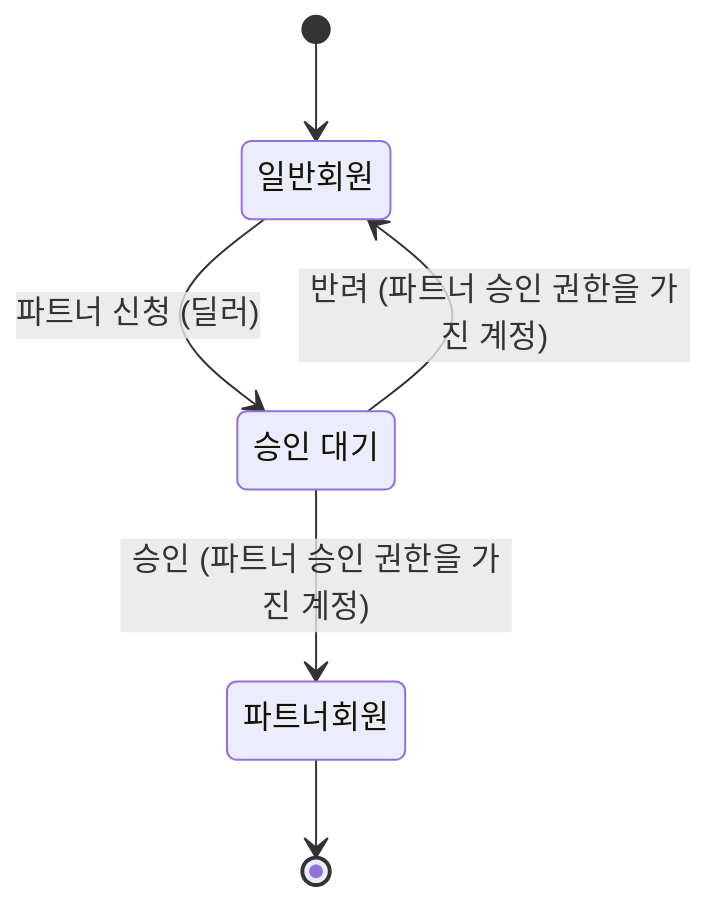

# 파트너회원 승인

기획 수준: 확정

## 업무 흐름: 회원 등급

- 처음: 일반회원
- 끝: 파트너회원

- '일반회원' 상태에서 '파트너 신청'이 일어나면 '승인 대기' 상태가 된다. (주체: 딜러)
- '승인 대기' 상태에서 '승인'이 일어나면 '파트너회원' 상태가 된다. (주체: 파트너 승인 권한을 가진 계정)
- '승인 대기' 상태에서 '반려'가 일어나면 '일반회원' 상태가 된다. (주체: 파트너 승인 권한을 가진 계정)
- 위에 적은 경우가 아니면 다음 사건은 받아들이지 않는다: '파트너 신청', '승인', '반려'

### 시나리오: approved

- 시작: 일반회원
- 사건 순서: 파트너 신청, 승인
- 기대 상태: 파트너회원

## 화면

- 공지사항 목록은 공지사항의 제목을 보여 준다. (주체: 공지 조회 권한을 가진 계정)
- 수수료율 목록은 수수료율의 비율을 보여 준다. (주체: 수수료율 조회 권한을 가진 계정)

## 권한

- 파트너 승인 (ApprovePartner)
  - 필요한 곳: 회원 등급의 '승인', 회원 등급의 '반려'
  - 부여하는 주체: 담당자
- 공지 조회 (ViewNotice)
  - 필요한 곳: 공지사항 목록
  - 부여하는 주체: 딜러, 담당자
- 수수료율 조회 (ViewRate)
  - 필요한 곳: 수수료율 목록
  - 부여하는 주체: 딜러, 담당자

## 부록

아래는 개발자를 위한 정리이다.
기본 자료형은 Text(글자), Int(정수), Decimal(소수), Money(금액), Bool(참 또는 거짓), Timestamp(시각), Duration(기간), Day(일), Week(주), Month(월)이다. 시간 값은 next(다음), before(이전), month_of(일이 속한 월)로 계산하고, 자료형 뒤의 물음표는 비어 있을 수 있음을, list는 여러 개를 뜻한다.

### 열거형

| 이름 | 값 | 근거 |
|---|---|---|
| 회원 구분 (MemberKind) | Corporate (법인), Individual (개인) | - |

### 엔티티

| 이름 | 유일성 키 | 필드 | 근거 |
|---|---|---|---|
| 공지사항 (Notice) | - | title (제목): Text | - |
| 수수료율 (Rate) | - | percent (비율): Decimal | - |
