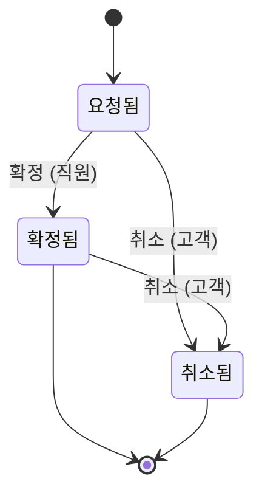
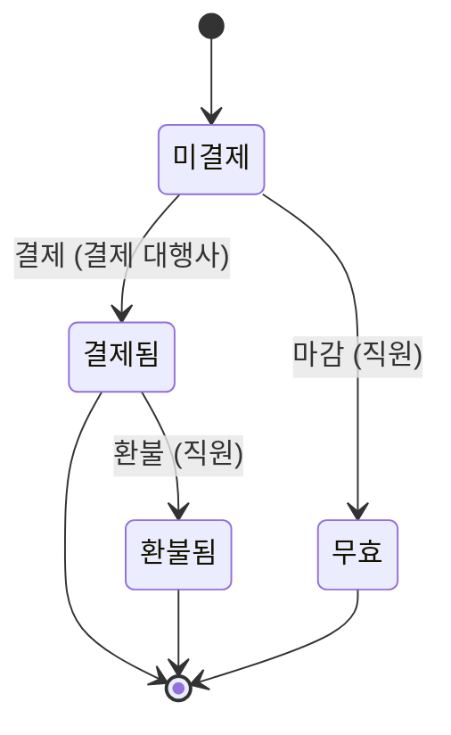

# 예약과 결제

## 초안

이 문서는 구멍이 남은 상태의 초안이며, 아래 구멍이 모두 해소되어야 확정된 기획서가 된다.

- INVARIANT_VIOLATED: invariant confirmed_is_paid over machine states fails after: Booking: Confirm (Booking=Confirmed, Payment=Unpaid)

## 업무 흐름: 예약

- 처음: 요청됨
- 끝: 확정됨, 취소됨

- '요청됨' 상태에서 '확정'이 일어나면 '확정됨' 상태가 된다. (주체: 직원)
- '요청됨' 상태에서 '취소'가 일어나면 '취소됨' 상태가 된다. (주체: 고객)
- '확정됨' 상태에서 '취소'가 일어나면 '취소됨' 상태가 된다. (주체: 고객)
- 위에 적은 경우가 아니면 다음 사건은 받아들이지 않는다: '확정', '취소'

## 업무 흐름: 결제

- 처음: 미결제
- 끝: 결제됨, 환불됨, 무효

- '미결제' 상태에서 예약이 '요청됨'일 때 '결제'가 일어나면 '결제됨' 상태가 된다. (주체: 결제 대행사)
- '결제됨' 상태에서 예약이 '취소됨'일 때 '환불'이 일어나면 '환불됨' 상태가 된다. (주체: 직원)
- '미결제' 상태에서 예약이 '취소됨'일 때 '마감'이 일어나면 '무효' 상태가 된다. (주체: 직원)
- 위에 적은 경우가 아니면 다음 사건은 받아들이지 않는다: '결제', '환불', '마감'

## 항상 성립하는 조건

- 확정된 예약은 결제가 끝난 예약이다.

## 부록

아래는 개발자를 위한 정리이다.
기본 자료형은 Text(글자), Int(정수), Decimal(소수), Money(금액), Bool(참 또는 거짓), Timestamp(시각), Duration(기간), Day(일), Week(주), Month(월)이다. 시간 값은 next(다음), before(이전), month_of(일이 속한 월)로 계산하고, 자료형 뒤의 물음표는 비어 있을 수 있음을, list는 여러 개를 뜻한다.

### 식

- confirmed_is_paid: `Booking = Confirmed ⇒ Payment = Paid`
