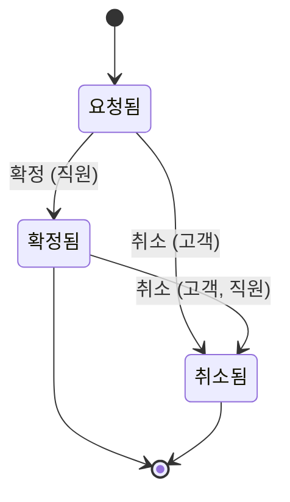
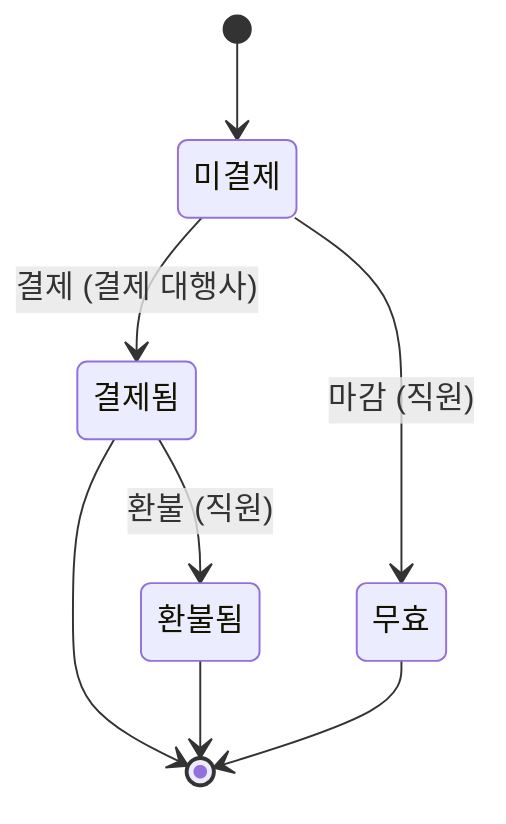

# 예약과 결제

기획 수준: 확정(잠정 결정을 현업이 모두 확인함)

## 업무 흐름: 예약

- 처음: 요청됨
- 끝: 확정됨, 취소됨

- '요청됨' 상태에서 결제가 '결제됨'일 때 '확정'이 일어나면 '확정됨' 상태가 된다. (주체: 직원)
- '요청됨' 상태에서 '취소'가 일어나면 '취소됨' 상태가 된다. (주체: 고객)
- '확정됨' 상태에서 '취소'가 일어나면 '취소됨' 상태가 된다. (주체: 고객, 직원)
- '요청됨' + '확정': 받아들이지 않는다
  - 근거: 결제 전에는 확정하지 않는다.
- 위에 적은 경우가 아니면 다음 사건은 받아들이지 않는다: '확정', '취소'

## 업무 흐름: 결제

- 처음: 미결제
- 끝: 결제됨, 환불됨, 무효

- '미결제' 상태에서 예약이 '요청됨'일 때 '결제'가 일어나면 '결제됨' 상태가 된다. (주체: 결제 대행사)
- '결제됨' 상태에서 예약이 '취소됨'일 때 '환불'이 일어나면 '환불됨' 상태가 된다. (주체: 직원)
- '미결제' 상태에서 예약이 '취소됨'일 때 '마감'이 일어나면 '무효' 상태가 된다. (주체: 직원)
- 위에 적은 경우가 아니면 다음 사건은 받아들이지 않는다: '결제', '환불', '마감'

### 시나리오: pay_confirm_cancel

- 시작: 예약 = 요청됨, 결제 = 미결제
- 사건 순서: 결제: 결제, 예약: 확정, 예약: 취소, 결제: 환불
- 기대 상태: 예약 = 취소됨, 결제 = 환불됨

## 항상 성립하는 조건

- 확정된 예약은 결제가 끝난 예약이다.

## 검증한 성질

- 결제 후 취소된 예약은 환불받을 수 있다.
- no_refund_while_alive

## 부록

아래는 개발자를 위한 정리이다.
기본 자료형은 Text(글자), Int(정수), Decimal(소수), Money(금액), Bool(참 또는 거짓), Timestamp(시각), Duration(기간), Day(일), Week(주), Month(월)이다. 시간 값은 next(다음), before(이전), month_of(일이 속한 월)로 계산하고, 자료형 뒤의 물음표는 비어 있을 수 있음을, list는 여러 개를 뜻한다.

### 식

- confirmed_is_paid: `Booking = Confirmed ⇒ Payment = Paid`
- refund_is_possible: `always Booking = Cancelled ∧ Payment = Paid ⇒ can (Payment = Refunded)`
- no_refund_while_alive: `always Payment = Refunded ⇒ Booking = Cancelled`
