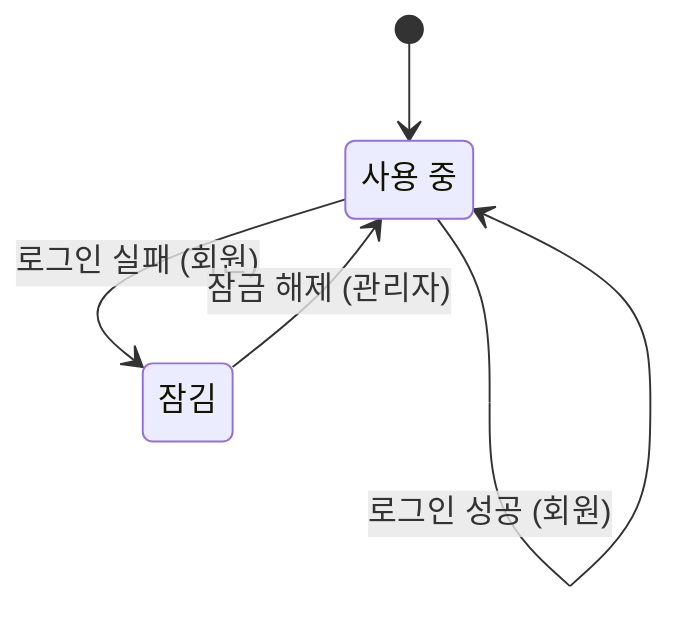

# 로그인 잠금

## 초안

이 문서는 구멍이 남은 상태의 초안이며, 아래 구멍이 모두 해소되어야 확정된 기획서가 된다.

- UNCOVERED: Active on Fail has no outcome when Tries=3, limit=4; Tries=3, limit=5; Tries=4, limit=5 (3 combinations)

## 확인이 필요한 가정

원문에 적혀 있지 않아 임시로 정한 내용이며, 현업 확인 전까지는 확정된 규칙이 아니다. 본문에서 이 가정에 기대는 줄에는 가정 표시를 붙였다.

| 이름 | 임시 값 | 출처 |
|---|---|---|
| 잠금까지의 실패 횟수 | 5회 | 보안 회의록 3행 |

## 정해지지 않은 값의 범위

- 잠금까지의 실패 횟수: 3 ~ 5 (가정: 잠금까지의 실패 횟수)

## 업무 흐름: 계정

- 처음: 사용 중
- 끝나지 않고 처음 상태로 돌아가며 반복되는 흐름
- 카운터: 연속 실패 횟수 (0 ~ 잠금까지의 실패 횟수)

- '사용 중' 상태에서 연속 실패 횟수가 '3'보다 작을 때 '로그인 실패'가 일어나면 '사용 중' 상태가 된다. (주체: 회원) (카운터: 연속 실패 횟수 +1)
- '사용 중' 상태에서 연속 실패 횟수가 '잠금까지의 실패 횟수'일 때 '로그인 실패'가 일어나면 '잠김' 상태가 된다. (주체: 회원)
- '사용 중' 상태에서 '로그인 성공'이 일어나면 '사용 중' 상태가 된다. (주체: 회원) (카운터: 연속 실패 횟수 0(으)로 되돌림)
- '잠김' 상태에서 '잠금 해제'가 일어나면 '사용 중' 상태가 된다. (주체: 관리자) (카운터: 연속 실패 횟수 0(으)로 되돌림)
- '잠김' + '로그인 실패': 받아들이지 않는다
- 위에 적은 경우가 아니면 다음 사건은 받아들이지 않는다: '로그인 성공', '잠금 해제'
