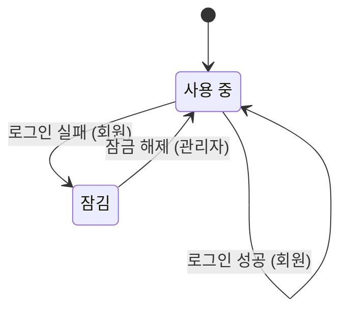

# 로그인 잠금

## 확인이 필요한 가정

원문에 적혀 있지 않아 임시로 정한 내용이며, 현업 확인 전까지는 확정된 규칙이 아니다. 본문에서 이 가정에 기대는 줄에는 가정 표시를 붙였다.

| 이름 | 임시 값 | 출처 |
|---|---|---|
| 잠금까지의 실패 횟수 | 5회 | 보안 회의록 3행 |

## 정해지지 않은 값의 범위

- 잠금까지의 실패 횟수: 3 ~ 5 (가정: 잠금까지의 실패 횟수)
  - 근거: 보안팀이 3회에서 5회 사이로 정하기로 했다.

## 업무 흐름: 계정

- 처음: 사용 중
- 끝나지 않고 처음 상태로 돌아가며 반복되는 흐름
- 카운터: 연속 실패 횟수 (0 ~ 잠금까지의 실패 횟수)

- '사용 중' 상태에서 연속 실패 횟수가 '잠금까지의 실패 횟수'보다 작을 때 '로그인 실패'가 일어나면 '사용 중' 상태가 된다. (주체: 회원) (카운터: 연속 실패 횟수 +1)
- '사용 중' 상태에서 연속 실패 횟수가 '잠금까지의 실패 횟수'일 때 '로그인 실패'가 일어나면 '잠김' 상태가 된다. (주체: 회원)
- '사용 중' 상태에서 '로그인 성공'이 일어나면 '사용 중' 상태가 된다. (주체: 회원) (카운터: 연속 실패 횟수 0(으)로 되돌림)
- '잠김' 상태에서 '잠금 해제'가 일어나면 '사용 중' 상태가 된다. (주체: 관리자) (카운터: 연속 실패 횟수 0(으)로 되돌림)
- 위에 적은 경우가 아니면 다음 사건은 받아들이지 않는다: '로그인 실패', '로그인 성공', '잠금 해제'

### 시나리오: lock_after_four

- 시작: 사용 중
- 사건 순서: 로그인 실패, 로그인 실패, 로그인 실패, 로그인 실패
- 기대 상태: 잠김

## 검증한 성질

- 잠금은 실패 횟수가 한도에 닿았을 때만 일어난다.
- 잠긴 계정은 언제든 다시 쓸 수 있게 된다.

## 부록

아래는 개발자를 위한 정리이다.
기본 자료형은 Text(글자), Int(정수), Decimal(소수), Money(금액), Bool(참 또는 거짓), Timestamp(시각), Duration(기간), Day(일), Week(주), Month(월)이다. 시간 값은 next(다음), before(이전), month_of(일이 속한 월)로 계산하고, 자료형 뒤의 물음표는 비어 있을 수 있음을, list는 여러 개를 뜻한다.

### 식

- locked_only_at_limit: `always Account = Locked ⇒ Tries = limit`
- never_stuck: `always can (Account = Active)`
