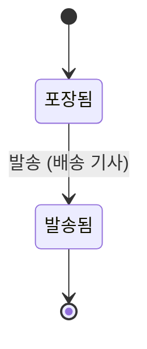
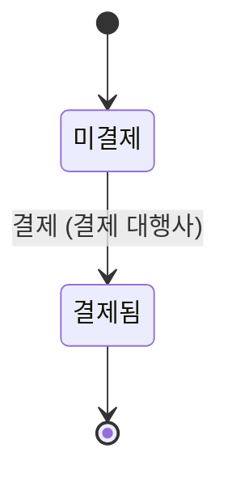

# 소포

기획 수준: 확정

## 업무 흐름: 배송

- 처음: 포장됨
- 끝: 발송됨
- 건마다 따로 진행되는 대상: 소포

- '포장됨' 상태에서 this.paid가 'Yes'일 때 '발송'이 일어나면 '발송됨' 상태가 된다. (주체: 배송 기사)
- 위에 적은 경우가 아니면 다음 사건은 받아들이지 않는다: '발송'
  - 근거: 결제되지 않은 소포는 발송하지 않는다.

## 업무 흐름: 결제

- 처음: 미결제
- 끝: 결제됨
- 건마다 따로 진행되는 대상: 소포

- '미결제' 상태에서 '결제'가 일어나면 '결제됨' 상태가 된다. (주체: 결제 대행사) (값 변경: 결제 여부 = 예)
- 위에 적은 경우가 아니면 다음 사건은 받아들이지 않는다: '결제'

### 시나리오: pay_first

- 시작: 미결제
- 사건 순서: 결제
- 기대 상태: 결제됨

## 할 수 있는 동안에는 결국 일어난다고 가정한 사건

- 결제: 결제
- 배송: 발송

## 검증한 성질

- 발송된 소포는 모두 결제된 소포이다.
- 결제된 소포의 결제 여부는 되돌아가지 않는다.
- 두 소포가 모두 발송되는 경우가 있다.
- 결제와 발송이 미뤄지지 않으면 모든 소포는 결국 발송된다.
- 결제된 소포는 결국 발송된다.

## 부록

아래는 개발자를 위한 정리이다.
기본 자료형은 Text(글자), Int(정수), Decimal(소수), Money(금액), Bool(참 또는 거짓), Timestamp(시각), Duration(기간), Day(일), Week(주), Month(월)이다. 시간 값은 next(다음), before(이전), month_of(일이 속한 월)로 계산하고, 자료형 뒤의 물음표는 비어 있을 수 있음을, list는 여러 개를 뜻한다.

### 식

- is_paid(p): `p.paid = Yes`
- bill(p): `p.Billing`
- shipped_is_paid: `always ∀ p ∈ Parcel : p.Flow = Shipped ⇒ p.paid = Yes`
- stays_paid: `always ∀ p ∈ Parcel : p.Billing = Settled ⇒ p.paid = Yes`
- both_ship: `reachable ∀ p ∈ Parcel : p.Flow = Shipped`
- all_ship: `eventually (∀ p ∈ Parcel : p.Flow = Shipped)`
- paid_ships: `always ∀ p ∈ Parcel : p.paid = Yes ⇒ eventually (p.Flow = Shipped)`

### 열거형

| 이름 | 값 | 근거 |
|---|---|---|
| 여부 (Flag) | No (아니오), Yes (예) | - |

### 엔티티

| 이름 | 유일성 키 | 필드 | 근거 |
|---|---|---|---|
| 소포 (Parcel) | id | id: Text paid (결제 여부): Flag [처음 값: No] | - |
