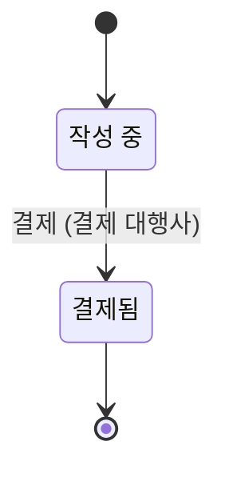

# 주문

기획 수준: PoC 가능

## 초안

이 문서는 구멍이 남은 상태의 초안이며, 아래 구멍이 모두 해소되어야 확정된 기획서가 된다.

- TRAP: state Draft of Order1.Flow cannot reach a terminal state once guards and counters are applied after: the start with Member1.standing=Suspended, Member2.standing=Active, Order1.buyer=Member1, Order2.buyer=Member1

## 업무 흐름: 주문 진행

- 처음: 작성 중
- 끝: 결제됨
- 건마다 따로 진행되는 대상: 주문

- '작성 중' 상태에서 this.buyer.standing가 'Active'일 때 '결제'가 일어나면 '결제됨' 상태가 된다. (주체: 결제 대행사)
- 위에 적은 경우가 아니면 다음 사건은 받아들이지 않는다: '결제'

## 부록

아래는 개발자를 위한 정리이다.
기본 자료형은 Text(글자), Int(정수), Decimal(소수), Money(금액), Bool(참 또는 거짓), Timestamp(시각), Duration(기간), Day(일), Week(주), Month(월)이다. 시간 값은 next(다음), before(이전), month_of(일이 속한 월)로 계산하고, 자료형 뒤의 물음표는 비어 있을 수 있음을, list는 여러 개를 뜻한다.

### 열거형

| 이름 | 값 | 근거 |
|---|---|---|
| 회원 상태 (Standing) | Active (정상), Suspended (정지) | - |

### 엔티티

| 이름 | 유일성 키 | 필드 | 근거 |
|---|---|---|---|
| 회원 (Member) | id | id: Text standing: Standing [변하지 않음] | - |
| 주문 (Order) | id | id: Text buyer (구매자): Member [변하지 않음] | - |
