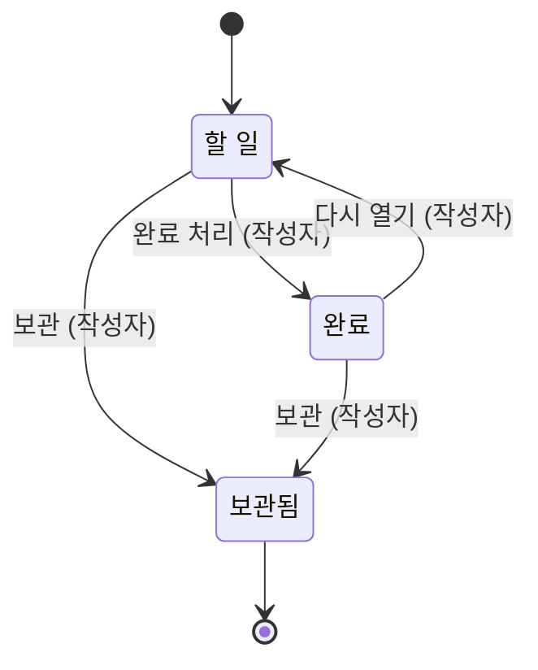

# 할 일 앱

기획 수준: 확정(잠정 결정을 현업이 모두 확인함)

## 시간 규칙

- 마감일은 작성일보다 앞설 수 없다.

## 업무 흐름: 진행

- 처음: 할 일
- 끝: 보관됨

- '할 일' 상태에서 '완료 처리'가 일어나면 '완료' 상태가 된다. (주체: 작성자)
- '완료' 상태에서 '다시 열기'가 일어나면 '할 일' 상태가 된다. (주체: 작성자)
- '할 일' 상태에서 '보관'이 일어나면 '보관됨' 상태가 된다. (주체: 작성자)
- '완료' 상태에서 '보관'이 일어나면 '보관됨' 상태가 된다. (주체: 작성자)
- 위에 적은 경우가 아니면 다음 사건은 받아들이지 않는다: '완료 처리', '다시 열기', '보관'

### 시나리오: finish_and_archive

- 시작: 할 일
- 사건 순서: 완료 처리, 보관
- 기대 상태: 보관됨

## 권한 규칙

- 작성자는 할 일에 대한 모든 동작을 할 수 있다.
  - 근거: 작성자는 자기 할 일을 언제나 보고 고친다.
- 공유 상태가 '공유됨'일 때, 공유받은 사람은 할 일을 조회할 수 있다.
- 공유 상태가 '비공개'일 때, 공유받은 사람은 할 일을 조회할 수 없다.
- 공유받은 사람은 할 일을 수정할 수 없다.
  - 근거: 공유받은 사람은 보기만 한다.

## 화면

- 할 일 목록은 할 일의 제목, 할 일의 마감일, 공유 상태를 보여 준다.

## 부록

아래는 개발자를 위한 정리이다.
기본 자료형은 Text(글자), Int(정수), Decimal(소수), Money(금액), Bool(참 또는 거짓), Timestamp(시각), Duration(기간), Day(일), Week(주), Month(월)이다. 시간 값은 next(다음), before(이전), month_of(일이 속한 월)로 계산하고, 자료형 뒤의 물음표는 비어 있을 수 있음을, list는 여러 개를 뜻한다.

### 식

- due_after_created: `Task.created_on <= Task.due_on`

### 열거형

| 이름 | 값 | 근거 |
|---|---|---|
| 공유 상태 (Sharing) | Private (비공개), Shared (공유됨) | 할 일을 다른 사람에게 보여 주는지를 나타낸다. |

### 엔티티

| 이름 | 유일성 키 | 필드 | 근거 |
|---|---|---|---|
| 할 일 (Task) | id | id: Text title (제목): Text created_on (작성일): Day due_on (마감일): Day? | 작성자가 적은 일 한 건이다. |

### 권한 요약

조건부는 행 상태나 업로드 상태 같은 조건에 따라 허용 여부가 달라진다는 뜻이며, 조건은 위의 규칙 문장을 따른다.

- 공유받은 사람: 할 일 수정 금지, 할 일 조회 조건부(공유 상태)
- 작성자: 할 일 수정 허용, 할 일 조회 허용
